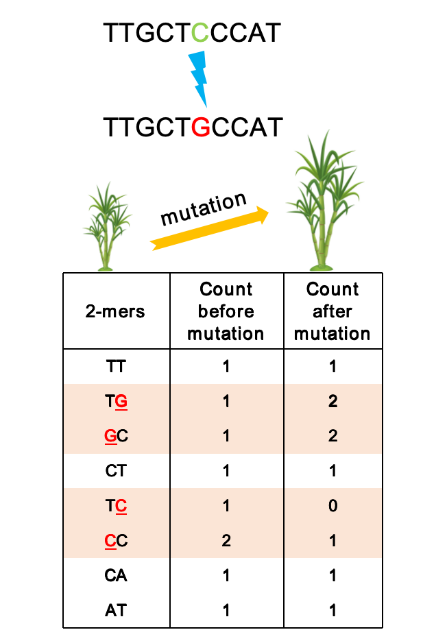
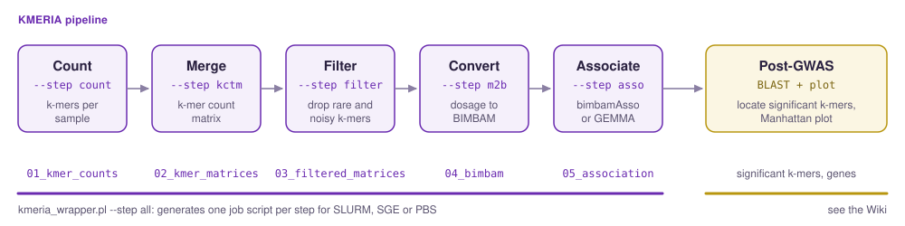
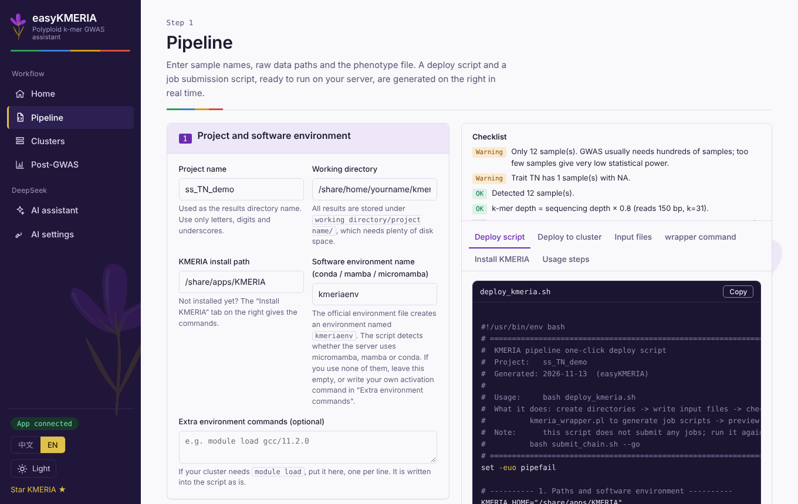
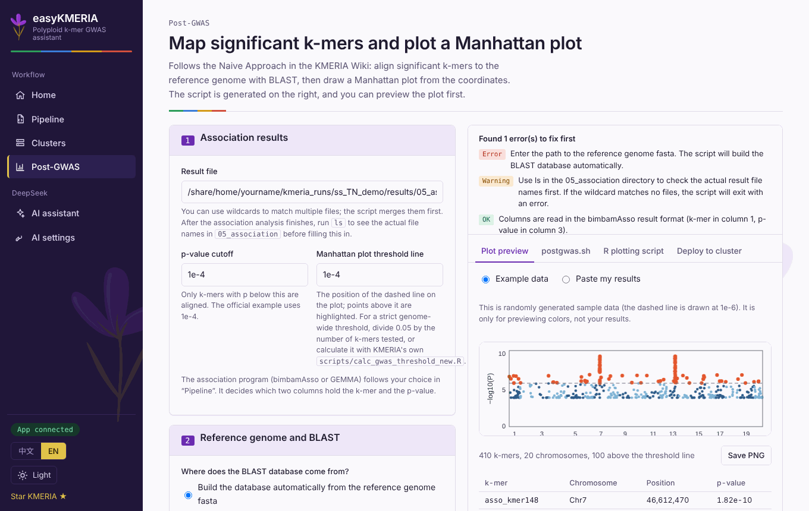

<p align="center">
  
</p>

<h1 align="center">KMERIA</h1>

<p align="center"><b>K-mer based genome-wide association on polyploids</b><br>
GWAS for sugarcane, potato, sweet potato, alfalfa and other complex polyploid genomes, with no read mapping or SNP calling. It also works on diploids.</p>

<p align="center">
  <a href="https://doi.org/10.1038/s41588-026-02641-8"></a>
  <a href="https://github.com/Sh1ne111/KMERIA/releases"></a>
  <a href="LICENSE"></a>
  
  <a href="https://github.com/Sh1ne111/KMERIA/stargazers"></a>
</p>

<p align="center">
  <a href="#quick-start">Quick start</a> ·
  <a href="https://github.com/Sh1ne111/KMERIA/wiki">Wiki</a> ·
  <a href="#easykmeria">easyKMERIA (GUI)</a> ·
  <a href="#faq">FAQ</a> ·
  <a href="#citation">Cite</a> ·
  <b>English</b> | <a href="README.zh-CN.md">简体中文</a>
</p>

---

## Why KMERIA

Identifying genotypes in a polyploid is hard: reads from several homologous or homoeologous copies pile up in the same place, and a variant has a dosage (0 to *n* copies) rather than a clean AA/AB/BB call. SNP-based GWAS also depends on a reference genome that may be incomplete or unavailable.

KMERIA works from the reads instead of a read alignment. It counts k-mers in each sample and uses the **k-mer copy number** as the genotype in the association test.

- **Independent of a reference genome** in the genotype-identification steps, which suits auto-polyploids and genomes with complex, variable structure.
- **Dosage is kept.** K-mer copy number gives more efficient estimates of additive effects in auto-polyploids and makes genotype identification simpler.
- **Sees more kinds of variation.** Structural and copy-number variants, which traditional GWAS often overlooks, change k-mer counts too.
- **Built for real cluster workflows.** `kmeria_wrapper.pl` writes ready-to-submit job scripts for SLURM, SGE and PBS; a graphical assistant ([easyKMERIA](#easykmeria)) is included.

<p align="center">
  <br>
  <sub>The idea: a base change alters the counts of every k-mer that covers it, and KMERIA runs the association on those counts.</sub>
</p>

### Results from the paper

KMERIA was published in *Nature Genetics* (2026). In the paper:

- the method is benchmarked on simulated and empirical data against existing methods;
- it is applied to **290 wild sugarcane (*Saccharum spontaneum*) accessions**, together with a graph pangenome built from 15 accessions to capture structural variation;
- it identifies genes behind sucrose biosynthesis (*SsMGT*) and tillering (including *SsERF14*, *SsNGA5*, *SsNAC*, *SsARF8*, *SsLOG* and *SsSCR*), which are candidate targets for sugarcane breeding.

For the figures, numbers and methods, please read the paper: [doi:10.1038/s41588-026-02641-8](https://doi.org/10.1038/s41588-026-02641-8).

## How it works

<p align="center"></p>

| Step | `--step` | What it does | Output folder |
| --- | --- | --- | --- |
| 1 | `count` | Count k-mers in each sample (`kmeria count`, or KMC with `--use-kmc`) | `01_kmer_counts` |
| 2 | `kctm` | Merge the per-sample counts into one k-mer count matrix | `02_kmer_matrices` |
| 3 | `filter` | Remove rare and noisy k-mers | `03_filtered_matrices` |
| 4 | `m2b` | Convert the matrix to BIMBAM format (BGZF compressed) | `04_bimbam` |
| 5 | `asso` | Association test with the built-in `bimbamAsso` (`--use-bimbam-tools`) or GEMMA | `05_association` |
| 6 | Post-GWAS | Map significant k-mers to a reference genome (BLAST) and draw a Manhattan plot; see the [Wiki](https://github.com/Sh1ne111/KMERIA/wiki/Post-GWAS-Analysis) | |

**You provide:** paired-end FASTQ files, a sample list, the sequencing depth of each sample, and a phenotype table.
**You get:** association results for k-mers, which you can map back to the genome and plot.

## Table of contents

- [Prerequisites](#prere)
- [Installation](#install)
- [Quick start](#quick-start)
- [easyKMERIA: graphical assistant](#easykmeria)
- [Documentation](#docs)
- [Command overview](#command-overview)
- [Miscellaneous tools](#misc)
- [FAQ](#faq)
- [Recent updates](#updates)
- [Third-party software](#third-party)
- [Contact](#contact)
- [Citation](#citation)

## <a name="prere"></a> Prerequisites

- Linux
- C/C++ compiler and GNU make (only needed if you build from source)
- conda, mamba or micromamba (recommended, to create the runtime environment)

## <a name="install"></a> Installation

##### Option 1:  Install pre‑built binaries

```bash
# 1. Clone the KMERIA repository
git clone https://github.com/Sh1ne111/KMERIA.git
# 2. (Recommended) Create a Conda virtual environment to avoid GNU C++ Runtime Library conflicts
#    Using mamba or micromamba can significantly speed up environment creation.
conda env create -f kmeria_env.yaml   # or: mamba env create -f kmeria_env.yaml
conda activate kmeriaenv
# 3. Set the library path for htslib (adjust the path to your actual KMERIA directory)
export LD_LIBRARY_PATH=/your_path/KMERIA/lib:$LD_LIBRARY_PATH
# 4. Grant execute permissions to binary files
chmod 755 /your_path/KMERIA/bin/* /your_path/KMERIA/external_tools/* /your_path/KMERIA/bimbamAsso/*
# 5. Add KMERIA directories to your PATH environment variable
export PATH=/your_path/KMERIA/bin:/your_path/KMERIA/bimbamAsso:/your_path/KMERIA/external_tools:$PATH
```

##### Option 2: Install from the source codes
If you prefer or need to compile KMERIA from source, start with the same `conda` environment setup as above:

```bash
# Complete the environment preparation
git clone https://github.com/Sh1ne111/KMERIA.git
conda env create -f kmeria_env.yaml   # or use mamba / micromamba
conda activate kmeriaenv
# htslib
export LD_LIBRARY_PATH=/your_path/KMERIA/lib:$LD_LIBRARY_PATH
# Navigate to the KMERIA directory
cd /your_path/KMERIA
make && make install
# (Optional) Clean up build artifacts
make clean
# Change Permissions
chmod 755 /your_path/KMERIA/bin/* /your_path/KMERIA/external_tools/* /your_path/KMERIA/bimbamAsso/*
#Add KMERIA directories to your PATH environment variable
export PATH=/your_path/KMERIA/bin:/your_path/KMERIA/bimbamAsso:/your_path/KMERIA/external_tools:$PATH
```

Check the install by running `kmeria`, which prints the command overview.

## <a name="quick-start"></a> Quick start

Pick the way that suits you. All three produce the same analysis.

| | Best for | Start here |
| --- | --- | --- |
| **easyKMERIA** (browser) | First-time users; no command line | [easyKMERIA](#easykmeria) |
| **`kmeria_wrapper.pl`** (one command) | Most users; writes all job scripts at once | the command below |
| **Step by step** | Custom pipelines, debugging | [Detailed tutorial](https://github.com/Sh1ne111/KMERIA/wiki/Detailed-Step-by-Step-Tutorial) |

`kmeria_wrapper.pl` writes job scripts for the whole pipeline, with built-in support for SLURM, SGE and PBS. We recommend it as the entry point.

```bash
perl /KMERIA/scripts/kmeria_wrapper.pl --step all \
  --input /path/to/fastq_files \
  --output /path/to/kmeria_results \
  --samples sample.list \
  --threads 32 \
  --kmer 31 \
  --min-abund 5 \
  --max-abund 1000 \
  --batch-size 2 \
  --use-kmc \   # Optional, default: kmeria count
  --kmc-memory 32 \
  --ploidy 4 \
  --depth-file /path/to/sample_depths.txt \   # k‑mer depth = sequencing depth × (L – k + 1) / L, where k is the k‑mer size and L is the read length.
  --pheno /path/to/phenotypes.txt \
  --pheno-col 1 \
  --use-bimbam-tools \   # Optional: Use built-in 'bimbamAsso' instead of 'gemma'
  --scheduler slurm \
  --queue hebhcnormal01
```

`--output` is the base directory: the wrapper creates `01_kmer_counts` … `05_association` under it. The wrapper only writes the job scripts, so submit them to your scheduler afterwards (`easyKMERIA` does this for you in dependency order).

**Want to try it first?** [`examples/`](examples) downloads a public sweet potato data set from SRA, simulates a phenotype and generates the job scripts: see [`examples/example.md`](examples/example.md).

## <a name="easykmeria"></a> easyKMERIA: graphical assistant

Prefer a browser to a terminal? [**easyKMERIA**](easyKMERIA) is a small local web app (Python, English / 中文 interface) for the whole workflow:

- fills in sample names, data paths and phenotypes and writes the `kmeria_wrapper.pl` pipeline scripts, with a checklist that catches common mistakes;
- logs in to your own SLURM/SGE/PBS cluster over SSH, uploads and submits the jobs in dependency order, and shows job status and logs;
- maps significant k-mers to a reference genome (BLAST) and draws a Manhattan plot, following the [Post-GWAS](https://github.com/Sh1ne111/KMERIA/wiki/Post-GWAS-Analysis) workflow;
- optionally uses DeepSeek to fill the form from one sentence, diagnose failed jobs and change plot parameters ("smaller points, 300 dpi PNG, label the top 10").

<p align="center"> </p>

```bash
cd easyKMERIA && ./start.sh      # Windows: start.bat; then open http://127.0.0.1:8765
```

It runs on your own computer; nothing is installed on the cluster. See the [easyKMERIA README](easyKMERIA/README.md) and the [user guide](easyKMERIA/docs/USER_GUIDE.md) ([中文](easyKMERIA/docs/USER_GUIDE.zh-CN.md)).

## <a name="docs"></a> Documentation

The [**KMERIA Wiki**](https://github.com/Sh1ne111/KMERIA/wiki) has step-by-step instructions, parameter explanations and advanced usage.

- **[Pipeline (Easy Mode)](https://github.com/Sh1ne111/KMERIA/wiki/Pipeline-(Easy-Mode))**: every `kmeria_wrapper.pl` parameter explained.
- **[Detailed Step-by-Step Tutorial](https://github.com/Sh1ne111/KMERIA/wiki/Detailed-Step-by-Step-Tutorial)**: the full workflow from raw reads to association results.
- **[Post-GWAS Analysis](https://github.com/Sh1ne111/KMERIA/wiki/Post-GWAS-Analysis)**: map associated k-mers and reads.
- **[Retrieve k-mer dosage](https://github.com/Sh1ne111/KMERIA/wiki/Retrieve-k%E2%80%90mer-dosage-from-the-k%E2%80%90mer-counting-matrices)**: get k-mer dosage from the counting matrices.
- **[easyKMERIA user guide](easyKMERIA/docs/USER_GUIDE.md)**: the graphical assistant.

## <a name="command-overview"></a> Command Overview
```
#===============================================================================#
#                                                                               #
#                 _  ____  __ ______ _____  _____                               #
#                | |/ /  \/  |  ____|  __ \|_   _|   /\                         #
#                | ' /| \  / | |__  | |__) | | |    /  \                        #
#                |  < | |\/| |  __| |  _  /  | |   / /\ \                       #
#                | . \| |  | | |____| | \ \ _| |_ / ____ \                      #
#                |_|\_|_|  |_|______|_|  \_\_____/_/    \_\                     #
#                                                                               #
#===============================================================================#

Program:  KMERIA - A KMER-based genome-wIde Association testing approach
          for polyploids

Version:  v2.0.4 (2026-06-12)
Author:   Chen Shuai <chensss1209@gmail.com>
GitHub:   https://github.com/Sh1ne111/KMERIA

Usage:    kmeria <command> [options]

Commands:

  Data Processing:
    count      Count k-mers from FASTA/FASTQ files
    dump       Convert binary k-mer file to plain text
    kctm       Build population k-mer counting matrix
    filter     Filter k-mer matrix by frequency and quality

  Format Conversion:
    m2b        Convert k-mer matrix to BIMBAM dosage format
    b2g        Convert BIMBAM format to genotype format

  Analysis:
    sketch     Random sampling for PCA and kinship calculation
    asso       Conduct k-mer genome-wide association study

  Utilities:
    fkr        Fetch reads associated k-mers from FASTQ files
    fkrtgs     Fetch reads associated k-mers from TGS FASTQ files
    kbam       Extract reads associated k-mers from BAM files
    addp       Annotate BAM with association p-values

Additional Help:
    kmeria <command> -h     Show detailed help for specific command
    Visit https://github.com/Sh1ne111/KMERIA for documentation

#===========================================================================#
#  Citation: If you use KMERIA, please cite our paper at                    #
#      [https://doi.org/10.1038/s41588-026-02641-8]                         #
#===========================================================================#
```

## <a name="misc"></a> Miscellaneous tools

Utility scripts in `/bin` and `/scripts`:

- `/bin/retrieve_kmer`: get k-mer dosage from filtered k-mer counting matrices.
- `/scripts/calc_gwas_threshold_new.R`: calculate the GWAS significance threshold.
- `/scripts/plot_manhattan.R`: helper script for Manhattan plots.

Usage instructions are on the [Wiki](https://github.com/Sh1ne111/KMERIA/wiki).

## <a name="faq"></a> FAQ

```
（1）Should I use kmeria count or KMC?
    Use kmeria count (default) for: 
           - Most standard analyses 
           - Direct KMERIA pipeline integration
    Use KMC (--use-kmc) for: 
            - Very large datasets (>100GB per sample) 
            - When you need strict abundance filtering 
            - Compatibility with other KMC-based workflows
            - Faster
    Consider: 
            - Shorter k-mers: More sensitive, more false positives, less memory 
            - Longer k-mers: More specific, fewer false positives, more memory

（2）How do I correct k‑mer depth for read length?
The effective k‑mer coverage depth is not equal to the nominal sequencing depth, because reads lose k‑mers near their ends. The correction formula is:
    k‑mer depth = sequencing depth × (L − k + 1) / L
where L is the read length and k is the k‑mer size (e.g., 31 for k-mer size). For example, with 150‑bp paired‑end reads and 31‑mers, the factor is (150−31+1)/150 = 0.8, so the k‑mer depth is only 80 % of the sequencing depth. This adjustment is critical for setting appropriate k‑mer count thresholds (e.g., minimum depth for reliable k‑mers).

（3）How do I process paired-end reads?
    Both methods automatically detect and process paired-end files: 
            - Files matching: sample_R1.fq.gz and sample_R2.fq.gz 
            - Or: sample_1.fq.gz and sample_2.fq.gz

（4）Can I restart a failed pipeline?
    Yes! Since each step generates independent job scripts: 
    1. Identify which step failed (check log files) 
    2. Fix the issue (add memory, correct input files, etc.) 
    3. Re-run only that specific step: --step count|kctm|filter|m2b|asso
    4. Continue with subsequent steps

（5）How do I speed up association analysis?
    The association step handles internal parallelism: 
     - Use --threads to set concurrency (e.g., 64) 
     - Ensure fast I/O (SSD storage) 
     - Pre-compute kinship and covariates
     Choose tool mode with --use-bimbam-tools for bimbamAsso mode.
```

More questions? Search or open an [issue](https://github.com/Sh1ne111/KMERIA/issues).

## <a name="updates"></a> Recent updates
* easyKMERIA 1.0.0 (2026.11.13)
  - New: a graphical assistant in [`easyKMERIA/`](easyKMERIA) that generates the pipeline scripts, submits jobs to your cluster, runs Post-GWAS (BLAST localization and Manhattan plot) and, optionally, uses DeepSeek to fill forms, diagnose logs and adjust plots. English and Chinese interface. See [easyKMERIA](#easykmeria).

* KMERIA Version 2.0.4 (2026.06.12)
  - Primarily focusing on hash function adjustments and memory usage optimization for 'kmeria count'. Additionally, the current version of `kmeria count` has extended the supported k‑mer size range to 2–63. Larger k‑mers are mainly intended for standard k‑mer analysis of genomic data and are not recommended for downstream kmer-based GWAS. If k‑mers are to be used for GWAS analysis, the k‑mer size should not exceed 31.
  
* KMERIA Version 2.0.3 (2026.02.06)
  - Fix the bug in parameter parsing of `kmeria count`

* KMERIA Version 2.0.2 (2026.02.05)
  - Introduced new parameters in `kmeria count` to control the output range of k-mer abundance, allowing for more efficient noise reduction.

* KMERIA Version 2.0.1 (2025.10.30):
  - K-mer matrix construction is now more efficient and consumes fewer resources;
  - Updated filter step to use new compressed output format;
  - Enhanced m2b step with BGZF compression and statistics;
  - Updated the association step to use our newly implemented Association tool **bimbamAsso**

* KMERIA Version 1.0.1 (2024.10.14) is no longer be maintained

## <a name="third-party"></a> Third-party software

KMERIA ships the following tools in `external_tools/`. If your analysis uses them, please cite them as well:

- **KMC** (k-mer counting): Kokot M, Długosz M, Deorowicz S. KMC 3: counting and manipulating k-mer statistics. *Bioinformatics* 33, 2759–2761 (2017).
- **GEMMA** (mixed-model association): Zhou X, Stephens M. Genome-wide efficient mixed-model analysis for association studies. *Nature Genetics* 44, 821–824 (2012).
- **PLINK**: Chang CC *et al.* Second-generation PLINK: rising to the challenge of larger and richer datasets. *GigaScience* 4, 7 (2015).

## <a name="contact"></a> Contact

Questions, bug reports and feature requests are welcome: open an [issue](https://github.com/Sh1ne111/KMERIA/issues), or write to Chen Shuai at chensss1209@gmail.com.

## <a name="citation"></a> Citation

If KMERIA helps your research, please cite our paper in *Nature Genetics*:

> Chen S, Liu X, Qu S, Song Y, Chai K, Liu H, Zhang Y, Xia Z, Li X, Wang J, Zhang M, Li H, Chen GB, Maliepaard C, Zhang X. A k-mer-based GWAS approach empowering gene mining in polyploids. *Nature Genetics* 58, 1711–1721 (2026). doi:[10.1038/s41588-026-02641-8](https://doi.org/10.1038/s41588-026-02641-8)

<details>
<summary>BibTeX</summary>

```bibtex
@article{chen2026kmeria,
  title   = {A k-mer-based GWAS approach empowering gene mining in polyploids},
  author  = {Chen, Shuai and Liu, Xinlong and Qu, Shenyang and Song, Yuhan and Chai, Kun and Liu, Hongbo and Zhang, Yuebin and Xia, Zhongqiang and Li, Xiaofeng and Wang, Jungang and Zhang, Muqing and Li, Hongbo and Chen, Guo Bo and Maliepaard, Chris and Zhang, Xingtan},
  journal = {Nature Genetics},
  volume  = {58},
  number  = {7},
  pages   = {1711--1721},
  year    = {2026},
  doi     = {10.1038/s41588-026-02641-8}
}
```

</details>

If KMERIA is useful to you, a ⭐ on GitHub helps other polyploid researchers find it.

<a href="https://star-history.com/#Sh1ne111/KMERIA&Date"></a>
