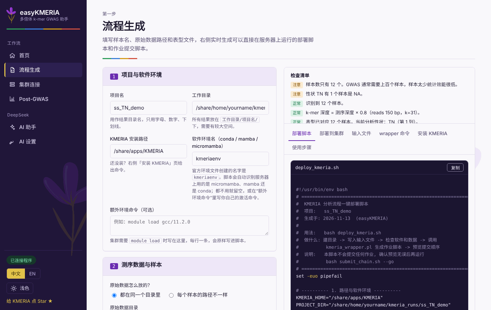

<p align="center">
  
</p>

<h1 align="center">KMERIA</h1>

<p align="center"><b>基于 k-mer 的多倍体全基因组关联分析</b><br>
适用于甘蔗、马铃薯、甘薯、苜蓿等复杂多倍体基因组，无需比对和 SNP 检测，二倍体同样适用。</p>

<p align="center">
  <a href="https://doi.org/10.1038/s41588-026-02641-8"></a>
  <a href="https://github.com/Sh1ne111/KMERIA/releases"></a>
  <a href="LICENSE"></a>
  
  <a href="https://github.com/Sh1ne111/KMERIA/stargazers"></a>
</p>

<p align="center">
  <a href="#quick-start">快速开始</a> ·
  <a href="https://github.com/Sh1ne111/KMERIA/wiki">Wiki</a> ·
  <a href="#easykmeria">easyKMERIA（图形界面）</a> ·
  <a href="#faq">常见问题</a> ·
  <a href="#citation">引用</a> ·
  <a href="README.md">English</a> | <b>简体中文</b>
</p>

---

## 为什么用 KMERIA

多倍体的基因型很难确定：来自多个同源或同源异体拷贝的 reads 会堆在同一个位置，变异的“剂量”是 0 到 *n* 个拷贝，而不是干净的 AA/AB/BB。基于 SNP 的 GWAS 还依赖参考基因组，而参考基因组可能不完整，甚至没有。

KMERIA 直接从 reads 出发，不依赖比对结果：统计每个样本的 k-mer，把 **k-mer 拷贝数**当作基因型做关联分析。

- **基因型识别不依赖参考基因组**，适合同源多倍体，以及结构复杂、变异多的基因组。
- **保留剂量信息**：k-mer 拷贝数让同源多倍体中加性效应的估计更有效，也简化了基因型的识别。
- **能看到更多类型的变异**：结构变异和拷贝数变异（传统 GWAS 常常忽略）同样会改变 k-mer 计数。
- **为集群工作流设计**：`kmeria_wrapper.pl` 直接写出可提交的 SLURM、SGE、PBS 作业脚本，还附带图形化助手（[easyKMERIA](#easykmeria)）。

<p align="center">
  <br>
  <sub>基本思路：一个碱基的改变会改变所有覆盖它的 k-mer 的计数，KMERIA 就在这些计数上做关联分析。</sub>
</p>


## 工作原理

| 步骤 | `--step` | 作用 | 输出目录 |
| --- | --- | --- | --- |
| 1 | `count` | 统计每个样本的 k-mer（`kmeria count`，或用 `--use-kmc` 调用 KMC） | `01_kmer_counts` |
| 2 | `kctm` | 把各样本的计数合并成一个 k-mer 计数矩阵 | `02_kmer_matrices` |
| 3 | `filter` | 过滤低频和噪声 k-mer | `03_filtered_matrices` |
| 4 | `m2b` | 转成 BIMBAM 格式（BGZF 压缩） | `04_bimbam` |
| 5 | `asso` | 用内置的 `bimbamAsso`（`--use-bimbam-tools`）或 GEMMA 做关联分析 | `05_association` |
| 6 | Post-GWAS | 用 BLAST 把显著 k-mer 定位到参考基因组并画曼哈顿图，见 [Wiki](https://github.com/Sh1ne111/KMERIA/wiki/Post-GWAS-Analysis) | |

**你需要提供：** 双端 FASTQ 文件、样本列表、每个样本的测序深度和表型表。
**你会得到：** k-mer 的关联分析结果，可以进一步定位回基因组并作图。

## 目录

- [环境要求](#prere)
- [安装](#install)
- [快速开始](#quick-start)
- [easyKMERIA：图形化助手](#easykmeria)
- [文档](#docs)
- [命令概览](#command-overview)
- [其他工具](#misc)
- [常见问题](#faq)
- [更新记录](#updates)
- [第三方软件](#third-party)
- [联系方式](#contact)
- [引用](#citation)

## <a name="prere"></a> 环境要求

- Linux
- C/C++ 编译器和 GNU make（只有从源码编译时需要）
- conda、mamba 或 micromamba（推荐，用来创建运行环境）

## <a name="install"></a> 安装

##### Option 1:  Install pre‑built binaries

```bash
# 1. Clone the KMERIA repository
git clone https://github.com/Sh1ne111/KMERIA.git
# 2. (Recommended) Create a Conda virtual environment to avoid GNU C++ Runtime Library conflicts
#    Using mamba or micromamba can significantly speed up environment creation.
conda env create -f kmeria_env.yaml   # or: mamba env create -f kmeria_env.yaml
conda activate kmeriaenv
# 3. Set the library path for htslib (adjust the path to your actual KMERIA directory)
export LD_LIBRARY_PATH=/your_path/KMERIA/lib:$LD_LIBRARY_PATH
# 4. Grant execute permissions to binary files
chmod 755 /your_path/KMERIA/bin/* /your_path/KMERIA/external_tools/* /your_path/KMERIA/bimbamAsso/*
# 5. Add KMERIA directories to your PATH environment variable
export PATH=/your_path/KMERIA/bin:/your_path/KMERIA/bimbamAsso:/your_path/KMERIA/external_tools:$PATH
```

##### Option 2: Install from the source codes
If you prefer or need to compile KMERIA from source, start with the same `conda` environment setup as above:

```bash
# Complete the environment preparation
git clone https://github.com/Sh1ne111/KMERIA.git
conda env create -f kmeria_env.yaml   # or use mamba / micromamba
conda activate kmeriaenv
# htslib
export LD_LIBRARY_PATH=/your_path/KMERIA/lib:$LD_LIBRARY_PATH
# Navigate to the KMERIA directory
cd /your_path/KMERIA
make && make install
# (Optional) Clean up build artifacts
make clean
# Change Permissions
chmod 755 /your_path/KMERIA/bin/* /your_path/KMERIA/external_tools/* /your_path/KMERIA/bimbamAsso/*
#Add KMERIA directories to your PATH environment variable
export PATH=/your_path/KMERIA/bin:/your_path/KMERIA/bimbamAsso:/your_path/KMERIA/external_tools:$PATH
```

安装后运行 `kmeria`，会打印命令概览，说明安装成功。

## <a name="quick-start"></a> 快速开始

三种方式任选，做的是同一个分析。

| | 适合 | 从这里开始 |
| --- | --- | --- |
| **easyKMERIA**（浏览器） | 第一次使用、不想敲命令行 | [easyKMERIA](#easykmeria) |
| **`kmeria_wrapper.pl`**（一条命令） | 大多数用户；一次写出全部作业脚本 | 下面的命令 |
| **逐步运行** | 自定义流程、排查问题 | [详细教程](https://github.com/Sh1ne111/KMERIA/wiki/Detailed-Step-by-Step-Tutorial) |

`kmeria_wrapper.pl` 会为整个流程写出作业脚本，内置支持 SLURM、SGE 和 PBS，推荐作为入口。

```bash
perl /KMERIA/scripts/kmeria_wrapper.pl --step all \
  --input /path/to/fastq_files \
  --output /path/to/kmeria_results \
  --samples sample.list \
  --threads 32 \
  --kmer 31 \
  --min-abund 5 \
  --max-abund 1000 \
  --batch-size 2 \
  --use-kmc \   # Optional, default: kmeria count
  --kmc-memory 32 \
  --ploidy 4 \
  --depth-file /path/to/sample_depths.txt \   # k‑mer depth = sequencing depth × (L – k + 1) / L, where k is the k‑mer size and L is the read length.
  --pheno /path/to/phenotypes.txt \
  --pheno-col 1 \
  --use-bimbam-tools \   # Optional: Use built-in 'bimbamAsso' instead of 'gemma'
  --scheduler slurm \
  --queue hebhcnormal01
```

`--output` 是基础目录，wrapper 会在它下面建 `01_kmer_counts` … `05_association`。wrapper 只写作业脚本，需要你再提交到调度系统（`easyKMERIA` 会按依赖顺序帮你提交）。

**想先试一试？** [`examples/`](examples) 会从 SRA 下载公开的甘薯数据，模拟表型并生成作业脚本，见 [`examples/example.md`](examples/example.md)。

## <a name="easykmeria"></a> easyKMERIA：图形化助手

更习惯用浏览器而不是终端？[**easyKMERIA**](easyKMERIA) 是一个在本机运行的小型网页程序（Python，中文 / English 界面），覆盖整个流程：

- 填入样本名、数据路径和表型，写出 `kmeria_wrapper.pl` 流程脚本，检查清单会拦住常见错误；
- 通过 SSH 登录你自己的 SLURM/SGE/PBS 集群，按依赖顺序上传并提交作业，查看作业状态和日志；
- 按 [Post-GWAS](https://github.com/Sh1ne111/KMERIA/wiki/Post-GWAS-Analysis) 流程，用 BLAST 把显著 k-mer 定位到参考基因组并画曼哈顿图；
- 可选的 DeepSeek 功能：一句话填表单、诊断失败的作业、修改绘图参数（“点小一点，300 dpi PNG，标出前 10 个”）。

<p align="center"> </p>

```bash
cd easyKMERIA && ./start.sh      # Windows: start.bat；然后打开 http://127.0.0.1:8765
```

它运行在你自己的电脑上，集群上不需要安装任何东西。详见 [easyKMERIA README](easyKMERIA/README.zh-CN.md) 和[使用指南](easyKMERIA/docs/USER_GUIDE.zh-CN.md)。

## <a name="docs"></a> 文档

[**KMERIA Wiki**](https://github.com/Sh1ne111/KMERIA/wiki) 有分步说明、参数解释和进阶用法（英文）。

- **[Pipeline (Easy Mode)](https://github.com/Sh1ne111/KMERIA/wiki/Pipeline-(Easy-Mode))**：`kmeria_wrapper.pl` 的全部参数。
- **[Detailed Step-by-Step Tutorial](https://github.com/Sh1ne111/KMERIA/wiki/Detailed-Step-by-Step-Tutorial)**：从原始 reads 到关联结果的完整流程。
- **[Post-GWAS Analysis](https://github.com/Sh1ne111/KMERIA/wiki/Post-GWAS-Analysis)**：定位关联的 k-mer 和 reads。
- **[Retrieve k-mer dosage](https://github.com/Sh1ne111/KMERIA/wiki/Retrieve-k%E2%80%90mer-dosage-from-the-k%E2%80%90mer-counting-matrices)**：从计数矩阵中取出 k-mer 剂量。
- **[easyKMERIA 使用指南](easyKMERIA/docs/USER_GUIDE.zh-CN.md)**：图形化助手。

## <a name="command-overview"></a> 命令概览
```
#===============================================================================#
#                                                                               #
#                 _  ____  __ ______ _____  _____                               #
#                | |/ /  \/  |  ____|  __ \|_   _|   /\                         #
#                | ' /| \  / | |__  | |__) | | |    /  \                        #
#                |  < | |\/| |  __| |  _  /  | |   / /\ \                       #
#                | . \| |  | | |____| | \ \ _| |_ / ____ \                      #
#                |_|\_|_|  |_|______|_|  \_\_____/_/    \_\                     #
#                                                                               #
#===============================================================================#

Program:  KMERIA - A KMER-based genome-wIde Association testing approach
          for polyploids

Version:  v2.0.4 (2026-06-12)
Author:   Chen Shuai <chensss1209@gmail.com>
GitHub:   https://github.com/Sh1ne111/KMERIA

Usage:    kmeria <command> [options]

Commands:

  Data Processing:
    count      Count k-mers from FASTA/FASTQ files
    dump       Convert binary k-mer file to plain text
    kctm       Build population k-mer counting matrix
    filter     Filter k-mer matrix by frequency and quality

  Format Conversion:
    m2b        Convert k-mer matrix to BIMBAM dosage format
    b2g        Convert BIMBAM format to genotype format

  Analysis:
    sketch     Random sampling for PCA and kinship calculation
    asso       Conduct k-mer genome-wide association study

  Utilities:
    fkr        Fetch reads associated k-mers from FASTQ files
    fkrtgs     Fetch reads associated k-mers from TGS FASTQ files
    kbam       Extract reads associated k-mers from BAM files
    addp       Annotate BAM with association p-values

Additional Help:
    kmeria <command> -h     Show detailed help for specific command
    Visit https://github.com/Sh1ne111/KMERIA for documentation

#===========================================================================#
#  Citation: If you use KMERIA, please cite our paper at                    #
#      [https://doi.org/10.1038/s41588-026-02641-8]                         #
#===========================================================================#
```

## <a name="misc"></a> 其他工具

`/bin` 和 `/scripts` 里还有几个实用脚本：

- `/bin/retrieve_kmer`：从过滤后的 k-mer 计数矩阵中取 k-mer 剂量。
- `/scripts/calc_gwas_threshold_new.R`：计算 GWAS 显著性阈值。
- `/scripts/plot_manhattan.R`：画曼哈顿图的辅助脚本。

用法见 [Wiki](https://github.com/Sh1ne111/KMERIA/wiki)。

## <a name="faq"></a> 常见问题

```
（1）用 kmeria count 还是 KMC？
    用 kmeria count（默认）：
           - 大多数常规分析
           - 与 KMERIA 流程直接衔接
    用 KMC（--use-kmc）：
            - 数据量很大（每个样本 >100GB）
            - 需要严格的丰度过滤
            - 需要与其他基于 KMC 的流程兼容
            - 速度更快
    另外：
            - k-mer 越短：越灵敏，假阳性越多，内存越少
            - k-mer 越长：越特异，假阳性越少，内存越多

（2）怎样按 read 长度校正 k-mer 深度？
有效的 k-mer 覆盖深度不等于标称测序深度，因为 read 两端会丢失一部分 k-mer。校正公式：
    k-mer 深度 = 测序深度 × (L − k + 1) / L
其中 L 是 read 长度，k 是 k-mer 长度（例如 31）。比如 150 bp 双端 reads、31-mer 时系数是 (150−31+1)/150 = 0.8，k-mer 深度只有测序深度的 80%。设置 k-mer 计数阈值（如可靠 k-mer 的最小深度）时这个校正很重要。

（3）怎样处理双端 reads？
    两种方式都会自动识别并处理双端文件：
            - 文件名形如：sample_R1.fq.gz 和 sample_R2.fq.gz
            - 或者：sample_1.fq.gz 和 sample_2.fq.gz

（4）失败的流程可以接着跑吗？
    可以。每一步都会生成独立的作业脚本：
    1. 根据日志文件找出哪一步失败
    2. 解决问题（加内存、改正输入文件等）
    3. 只重跑那一步：--step count|kctm|filter|m2b|asso
    4. 再继续后面的步骤

（5）怎样加快关联分析？
    关联分析步骤内部已做并行：
     - 用 --threads 设置并发数（例如 64）
     - 保证 I/O 够快（SSD 存储）
     - 预先计算亲缘关系矩阵和协变量
     用 --use-bimbam-tools 选择 bimbamAsso 模式。
```

更多问题？欢迎搜索或提交 [issue](https://github.com/Sh1ne111/KMERIA/issues)。

## <a name="updates"></a> 更新记录

更新记录以英文写在 [README.md](README.md#updates) 中。

## <a name="contact"></a> 联系方式

欢迎提问、报告问题和提出建议：提交 [issue](https://github.com/Sh1ne111/KMERIA/issues)，或发邮件给 Chen Shuai：chensss1209@gmail.com。

## <a name="citation"></a> 引用

如果 KMERIA 对你的研究有帮助，请引用我们发表在 *Nature Genetics* 的论文：

> Chen S, Liu X, Qu S, Song Y, Chai K, Liu H, Zhang Y, Xia Z, Li X, Wang J, Zhang M, Li H, Chen GB, Maliepaard C, Zhang X. A  k-mer-based genome-wide association study approach empowering gene mining in polyploids. *Nature Genetics* 58, 1711–1721 (2026). doi:[10.1038/s41588-026-02641-8](https://doi.org/10.1038/s41588-026-02641-8)

<details>
<summary>BibTeX</summary>

```bibtex
@article{chen2026kmeria,
  title   = {A k-mer-based genome-wide association study  approach empowering gene mining in polyploids},
  author  = {Chen, Shuai and Liu, Xinlong and Qu, Shenyang and Song, Yuhan and Chai, Kun and Liu, Hongbo and Zhang, Yuebin and Xia, Zhongqiang and Li, Xiaofeng and Wang, Jungang and Zhang, Muqing and Li, Hongbo and Chen, Guo Bo and Maliepaard, Chris and Zhang, Xingtan},
  journal = {Nature Genetics},
  volume  = {58},
  number  = {7},
  pages   = {1711--1721},
  year    = {2026},
  doi     = {10.1038/s41588-026-02641-8}
}
```

</details>

如果 KMERIA 对你有用，欢迎在 GitHub 上点个 ⭐，让更多做多倍体研究的同行看到它。

<a href="https://star-history.com/#Sh1ne111/KMERIA&Date"></a>
