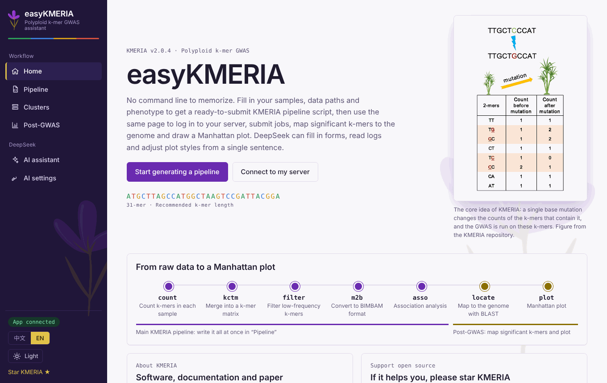
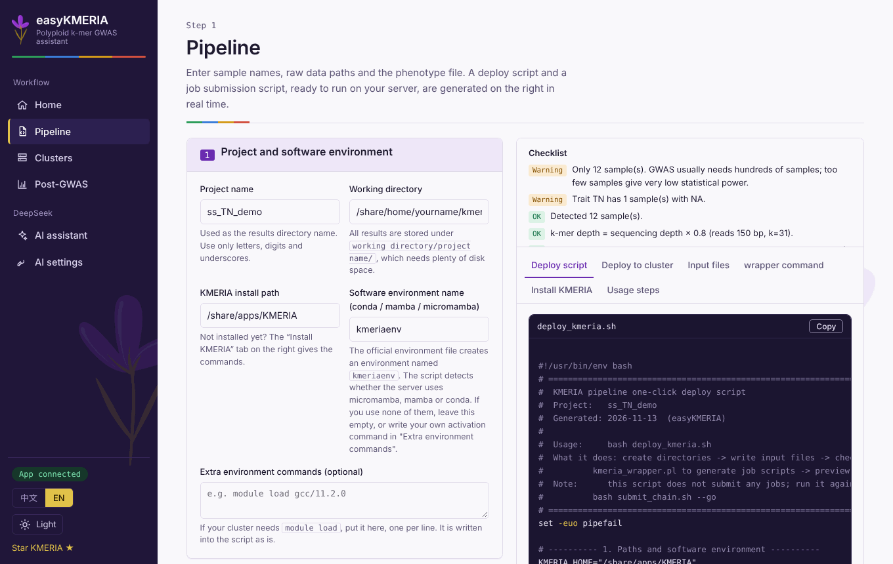
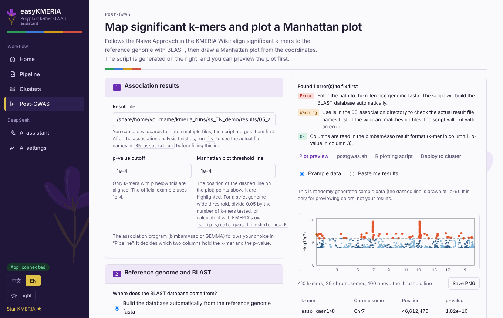

# easyKMERIA

**A graphical assistant for [KMERIA](https://github.com/Sh1ne111/KMERIA)** — polyploid k-mer GWAS without memorising the command line.

English | [简体中文](README.zh-CN.md)

<p align="center"></p>

easyKMERIA is a small local web app. Fill in your samples, raw-data paths and phenotypes in the browser and it writes the scripts for the whole KMERIA pipeline (`kmeria_wrapper.pl`). It can then log in to your own Linux cluster over SSH, upload and submit the jobs, map significant k-mers to a reference genome with BLAST, and draw a Manhattan plot. An optional DeepSeek integration fills in forms from one sentence, reads failed logs, and adjusts the plot.

Nothing needs to be installed on the cluster, and nothing leaves your computer except what you send to DeepSeek (see [Security](#security)).

## Quick start

Requires Python 3.9 or newer, on your own computer (or a lab machine on a trusted network).

```bash
cd easyKMERIA
./start.sh            # Windows: double-click start.bat
```

The first run creates a virtual environment and installs the dependencies, then opens <http://127.0.0.1:8765>. Manual start: `pip install -r requirements.txt && python app.py --open`.

Without the backend you can still open `static/index.html` directly: script generation and the Manhattan-plot preview work, but logging in to a server and calling DeepSeek do not.

## What it does

| Page | What it does |
| --- | --- |
| **Pipeline** | Sample names, data paths and phenotypes → `deploy_kmeria.sh` (creates folders, writes the input files, checks software and data, calls `kmeria_wrapper.pl`) and `submit_chain.sh` (submits each step with job dependencies). A live checklist flags mistakes before anything runs. |
| **Clusters** | Save SSH logins (password or private key), detect the scheduler (SLURM / SGE / PBS) and queues, then upload, run, submit and read job logs from the page. |
| **Post-GWAS** | Follows the Naive Approach in the KMERIA Wiki: p-value cutoff → BLAST → coordinates → Manhattan plot; optionally lists nearby genes from a GFF3 file. |
| **AI assistant** | Fill the form from one sentence, check/install KMERIA, diagnose the latest failed run, or run the whole pipeline with an approval click at every step that changes the server. |
| **AI settings** | Store a DeepSeek API key. |

<p align="center">
  
  
</p>

Other things worth knowing:

- **English / 中文** — switch at the bottom of the sidebar. The page reloads; generated scripts, checklists and the DeepSeek answers follow the language. The default follows your browser.
- **Light / dark / auto** theme.
- **micromamba / mamba / conda** are detected automatically on the server, and every job script loads the environment itself, so `kmc` and friends are found on compute nodes. See the [user guide](docs/USER_GUIDE.md#software-environment).
- **Manhattan plot by sentence** — "smaller points, 300 dpi PNG, hide the threshold line, label the top 10". See the [user guide](docs/USER_GUIDE.md#change-the-plot-with-deepseek).

## Documentation

- [User guide](docs/USER_GUIDE.md) — step-by-step walkthrough, AI assistant, troubleshooting ([中文](docs/USER_GUIDE.zh-CN.md))

## Security

- Listens on `127.0.0.1` only. A random token is generated at each start, every API call must carry it, and Host and Origin are checked so other web pages cannot talk to your local app.
- Passwords, private keys and the API key are encrypted with Fernet under `~/.easykmera/` (change it with `EASYKMERA_HOME`). The key file sits in the same folder with mode 600: it protects against casual viewing and backups, not against someone who can read your whole home directory.
- The first connection records the server fingerprint; a changed fingerprint is refused.
- There is no arbitrary command execution. The backend only uploads scripts, runs scripts in a directory with whitelisted arguments, submits with `sbatch`/`qsub`, lists jobs and reads logs, all confined to the connection's working path.
- DeepSeek receives only what you type plus, for diagnosis, the last lines of a log with passwords, keys and email addresses masked. No genome or phenotype data is sent. The model only returns form values (validated against a whitelist) and text; it never produces commands.
- There is no user system. If you put it on a shared lab server, everyone who can reach the port shares the saved accounts, so do it only on a trusted network: `EASYKMERA_ALLOWED_HOSTS=your-host python app.py --host 0.0.0.0`.

## Known limitations

- Password login supports plain passwords only. Clusters that require two-factor codes need a private key.
- Post-GWAS implements the Naive Approach (BLAST) only, not the fkr / minimap2 route. "Nearby genes" is an easyKMERIA extension, not part of the official workflow.
- One trait per run.
- The KMERIA installer step has not been validated against every cluster; it checks that the `kmeria` command is found afterwards.
- Job monitoring recognises "a later job waits forever because an earlier one failed" on SLURM; on SGE/PBS a failure is detected only as "the job ended without result files".

## Development

```
app.py             backend (Flask + paramiko)
static/index.html  front end, generated from src/
src/               page sources and script templates; `python src/build.py` regenerates static/
tests/             test_backend.py, test_deploy_env.py, e2e_ui.py, e2e_agent.py, pg/ (Post-GWAS test data)
```

```bash
python tests/test_backend.py
python tests/test_deploy_env.py
cd tests/pg && python mk.py && cd ../..     # simulated genome and association results
python tests/e2e_ui.py                      # needs playwright, blast+, bedtools, samtools, R
```

The wrapper layout assumed by `submit_chain.sh` was checked against `kmeria_wrapper.pl` v2.0.4: `--output` is the base directory and the wrapper creates `01_kmer_counts` … `05_association` under it, so easyKMERIA always passes `--output <project>/results`.

## Citation

If you use KMERIA, please cite: Chen Shuai *et al.* A k-mer-based genome-wide association study approach empowering gene mining in polyploids. *Nature Genetics* (2026). doi:[10.1038/s41588-026-02641-8](https://doi.org/10.1038/s41588-026-02641-8).

Licensed under the same [MIT License](../LICENSE) as KMERIA.
