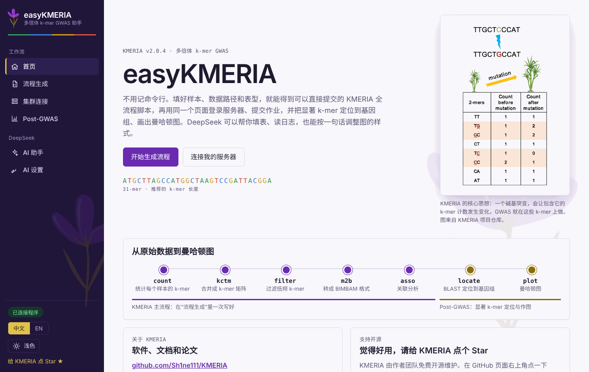
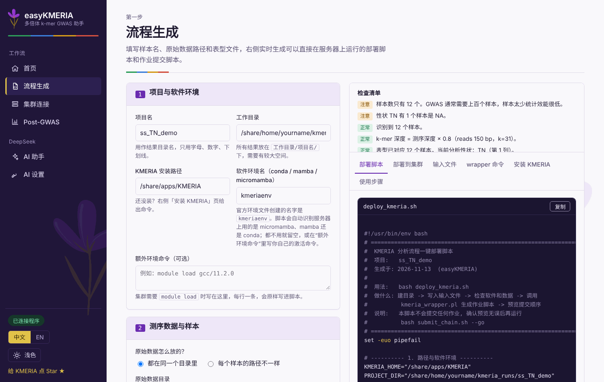
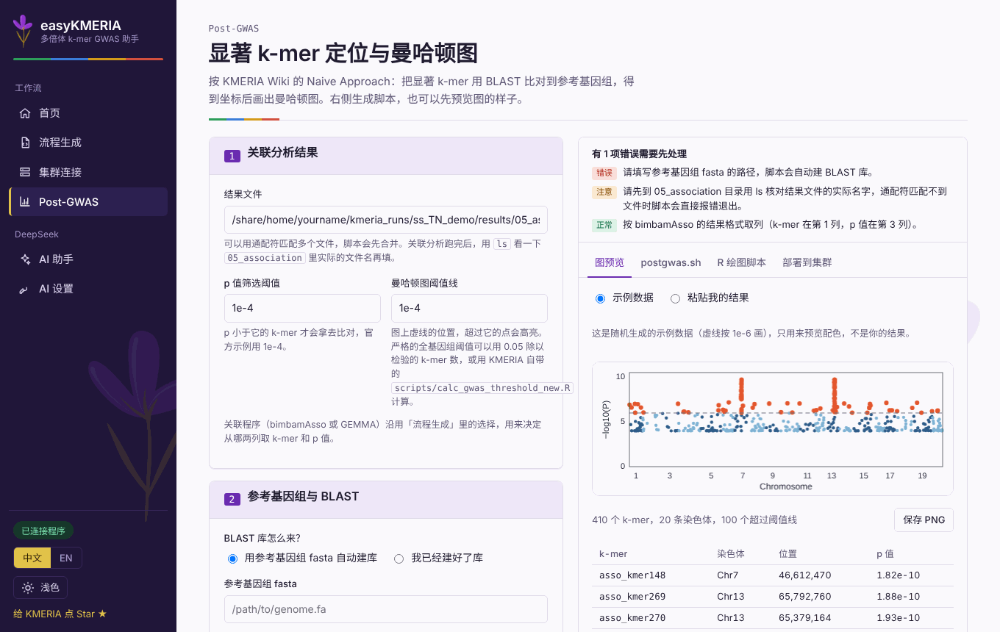

# easyKMERIA

**[KMERIA](https://github.com/Sh1ne111/KMERIA) 的图形化助手** —— 做多倍体 k-mer GWAS，不用背命令行。

[English](README.md) | 简体中文

<p align="center"></p>

easyKMERIA 是一个在本机运行的小型网页程序。在浏览器里填样本名、原始数据路径和表型，它就生成整套 KMERIA 流程（`kmeria_wrapper.pl`）的脚本；还能通过 SSH 登录你自己的 Linux 集群，上传并提交作业，用 BLAST 把显著 k-mer 定位到参考基因组，并画出曼哈顿图。可选的 DeepSeek 功能可以一句话填表单、读失败日志、调整曼哈顿图。

集群上不需要安装任何东西；除了你主动发给 DeepSeek 的内容，数据不会离开你的电脑（见[安全说明](#安全说明)）。

## 快速开始

需要 Python 3.9 以上，装在你自己的电脑上（或可信内网里的实验室机器）。

```bash
cd easyKMERIA
./start.sh            # Windows 双击 start.bat
```

第一次运行会自动建虚拟环境、装依赖，然后打开 <http://127.0.0.1:8765>。手动运行：`pip install -r requirements.txt && python app.py --open`。

不运行后端也可以直接双击打开 `static/index.html`：脚本生成和曼哈顿图预览可用，但不能登录服务器，也不能调用 DeepSeek。

## 功能

| 页面 | 作用 |
| --- | --- |
| **流程生成** | 样本名、数据路径、表型 → `deploy_kmeria.sh`（建目录、写输入文件、检查软件和数据、调用 `kmeria_wrapper.pl`）和 `submit_chain.sh`（按依赖顺序提交各步骤作业）。右侧实时检查清单，运行前就能发现常见错误。 |
| **集群连接** | 保存 SSH 账号（密码或私钥），识别调度系统（SLURM / SGE / PBS）和队列；在页面里上传、运行、提交、看作业和日志。 |
| **Post-GWAS** | 按官方 Wiki 的 Naive Approach：p 值阈值筛选 → BLAST → 坐标 → 曼哈顿图；可选用 GFF3 列出附近基因。 |
| **AI 助手** | 一句话填表单、检查并安装 KMERIA、诊断最近一次失败、一键跑完整流程（每一步改动服务器的操作都要你点“批准”）。 |
| **AI 设置** | 保存 DeepSeek API Key。 |

<p align="center">
  
  
</p>

其他值得知道的：

- **中文 / English**：在左侧导航底部切换，页面会重新加载；生成的脚本、检查清单和 DeepSeek 的回答都会跟着语言变化，默认跟随浏览器语言。
- 浅色 / 深色 / 自动主题。
- 服务器上的 **micromamba / mamba / conda** 会自动识别，每个作业脚本都会自己加载环境，计算节点上也找得到 `kmc` 等命令，见[使用指南](docs/USER_GUIDE.zh-CN.md#软件环境)。
- **一句话改曼哈顿图**：“点小一点，导出 300 dpi PNG，隐藏阈值线，标出前 10 个”，见[使用指南](docs/USER_GUIDE.zh-CN.md#用-deepseek-改曼哈顿图)。

## 文档

- [使用指南](docs/USER_GUIDE.zh-CN.md)：分步教程、AI 助手、常见问题（[English](docs/USER_GUIDE.md)）

## 安全说明

- 默认只监听 `127.0.0.1`。每次启动生成一个随机令牌，所有接口都要带它，并校验 Host 和 Origin，防止别的网页偷偷调用你本机的接口。
- 密码、私钥、API Key 用 Fernet 加密后存在 `~/.easykmera/`（可用环境变量 `EASYKMERA_HOME` 改位置）。密钥文件和数据在同一目录，权限 600。它能防止数据文件被随手看到或被备份带走，但挡不住能读你整个用户目录的人。
- 第一次连接记录服务器指纹，之后指纹变了会拒绝连接。
- 后端不提供任意命令执行，只允许：上传脚本、用 bash 运行目录里的脚本（参数白名单）、用 sbatch/qsub 提交脚本、查作业、看日志，且都限制在连接的“工作路径”内。
- 发给 DeepSeek 的只有你写的描述；诊断时会附上日志末尾几十行，其中的密码、Key、邮箱会先打码。不会发送基因组或表型数据。模型只返回表单取值（后端按白名单校验）和文字建议，不会生成命令。
- 程序没有用户系统。放到实验室服务器上让多人用时，所有能访问端口的人共用同一批保存的账号，请只在可信内网里这样做：`EASYKMERA_ALLOWED_HOSTS=你的主机名 python app.py --host 0.0.0.0`。

## 已知限制

- 密码登录只支持普通密码；要求二次验证的集群请用私钥。
- Post-GWAS 只实现了 Naive Approach（BLAST），没有 fkr / minimap2 路线。“附近的基因”是 easyKMERIA 加的扩展，不是官方流程。
- 一次只分析一个性状。
- 安装 KMERIA 的步骤没有在所有集群上验证过；它会在安装后检查 `kmeria` 命令能否找到。
- 作业监控在 SLURM 下能识别“前一步失败导致后续作业一直等待”；SGE/PBS 下只能靠“作业结束但没有结果文件”判断。

## 开发

```
app.py             后端（Flask + paramiko）
static/index.html  前端，由 src/ 合并生成
src/               页面源码和脚本模板，python src/build.py 重新生成 static/
tests/             test_backend.py、test_deploy_env.py、e2e_ui.py、e2e_agent.py、pg/（Post-GWAS 测试数据）
```

```bash
python tests/test_backend.py
python tests/test_deploy_env.py
cd tests/pg && python mk.py && cd ../..     # 生成模拟基因组和关联结果
python tests/e2e_ui.py                      # 需要 playwright、blast+、bedtools、samtools、R
```

`submit_chain.sh` 假定的目录结构已对照 `kmeria_wrapper.pl` v2.0.4 核对过：`--output` 是基础目录，wrapper 会在它下面建 `01_kmer_counts` … `05_association`，所以 easyKMERIA 始终传 `--output <项目>/results`。

## 引用

使用 KMERIA 请引用：Chen Shuai *et al.* A k-mer-based GWAS approach empowering gene mining in polyploids. *Nature Genetics* (2026). doi:[10.1038/s41588-026-02641-8](https://doi.org/10.1038/s41588-026-02641-8)。

与 KMERIA 相同，使用 [MIT 许可证](../LICENSE)。
