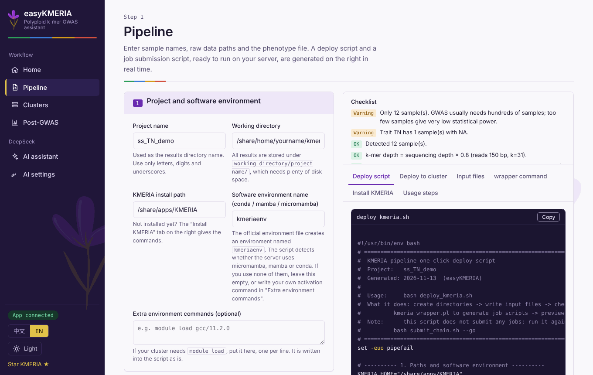
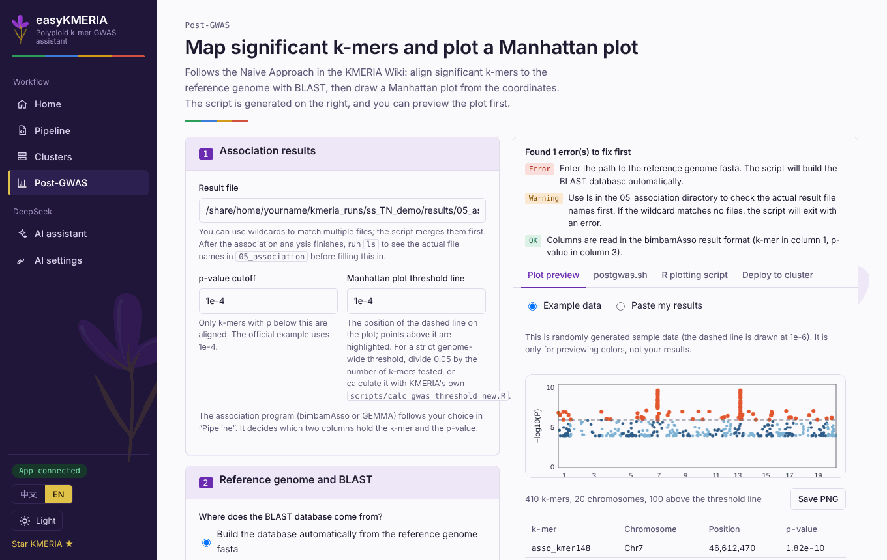
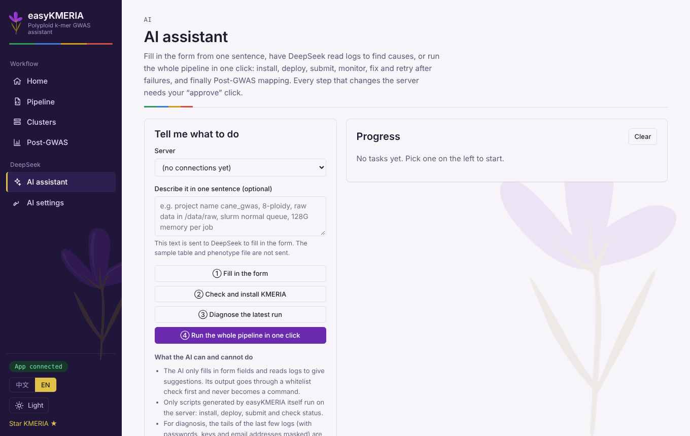

# easyKMERIA user guide

English | [简体中文](USER_GUIDE.zh-CN.md)

This guide walks through a complete analysis: from raw sequencing data to a Manhattan plot. If you only want the scripts, steps 1–2 are enough; everything else is optional convenience.

Contents: [Start the app](#start-the-app) · [1. Pipeline](#1-pipeline-generate-the-scripts) · [2. Connect your server](#2-connect-your-server) · [3. Deploy and submit](#3-deploy-and-submit) · [4. Post-GWAS](#4-post-gwas-locate-significant-k-mers-and-plot) · [AI assistant](#ai-assistant) · [Software environment](#software-environment) · [Troubleshooting](#troubleshooting)

## Start the app

```bash
cd easyKMERIA
./start.sh            # Windows: double-click start.bat
```

Open <http://127.0.0.1:8765> if the browser does not open by itself. Use the language buttons at the bottom of the sidebar to switch between English and 中文 (the page reloads).

You need a Linux cluster account that you can reach over SSH, and KMERIA installed there (or let the [AI assistant](#ai-assistant) install it). The app runs on your own computer; nothing is installed on the cluster.

## 1. Pipeline: generate the scripts

<p align="center"></p>

Open **Pipeline** and fill in the form on the left. The right side updates as you type.

1. **Project and software environment.** Project name (used as a folder name), working directory (all results go under `working directory/project name/`, so choose a disk with plenty of space), the KMERIA install path, and the conda / mamba / micromamba environment name (`kmeriaenv` if you used the official `kmeria_env.yaml`).
2. **Sequencing data and samples.** Choose how your raw data is laid out. Either point to one folder whose files are named `sample_R1.fq.gz` / `sample_R2.fq.gz`, or give the R1/R2 path of every sample in the table (easyKMERIA then links them under uniform names and never touches your originals). One line per sample: sample name, sequencing depth, and optionally ploidy.
3. **Phenotype file.** Paste or upload a table with sample names and one or more traits. Choose which trait to analyse; missing values are `NA`.
4. **Analysis parameters.** Ploidy, k-mer size (31 is the recommended maximum for GWAS), min/max abundance, missing-rate threshold, counter (`kmeria count` or KMC), association tool (`bimbamAsso` or GEMMA), scheduler, queue, threads, memory and time. **Which steps to run: leave it on "all steps" unless you really want to re-run one step.**

The **Checklist** at the top right flags problems before anything runs, for example too few samples, samples without phenotypes, or an install path that is not absolute. Fix the red items first.

The tabs on the right show what will be produced:

| Tab | Content |
| --- | --- |
| Deploy script | `deploy_kmeria.sh`: creates folders, writes the input files, checks software and data, calls `kmeria_wrapper.pl`, and writes `submit_chain.sh` |
| Deploy to cluster | the same, but run from this page (see step 3) |
| Input files | `sample.list`, `sample_depth.tsv`, `phenotypes.txt` for you to double-check |
| wrapper command | the single `kmeria_wrapper.pl` command used, with paths expanded; handy for comparing with the KMERIA Wiki |
| Install KMERIA | the official pre-built install commands |

You can also copy `deploy_kmeria.sh` and run it yourself on the cluster: `bash deploy_kmeria.sh`. It only prepares and previews; it never submits jobs.

## 2. Connect your server

Open **Clusters** and click add. Enter host, port, user name and either a password or a private key, plus your working directory and queue. **Test** logs in, records the server fingerprint, and detects the scheduler and the available environment manager. Passwords and keys are stored encrypted on your own computer.

## 3. Deploy and submit

On **Pipeline → Deploy to cluster**, choose the saved server and go through three buttons:

1. **Upload and run** — sends `deploy_kmeria.sh` to the project folder and runs it. This creates `results/` and writes the job scripts. No job is submitted.
2. **Submit jobs** — runs `submit_chain.sh --go`. The first click arms the button; click again to confirm. Each step's jobs are submitted so that they start only after the previous step has finished successfully.
3. **Refresh status** — lists your queued and running jobs.

Below the buttons you can browse the server's directories and read the last 150 lines of any log.

The results are laid out like this:

```
<working directory>/<project>/
├── sample.list  sample_depth.tsv  phenotypes.txt
├── deploy_kmeria.sh  submit_chain.sh  easykmeria_env.sh
└── results/
    ├── 01_kmer_counts/  02_kmer_matrices/  03_filtered_matrices/  04_bimbam/
    └── 05_association/      <- association results
```

## 4. Post-GWAS: locate significant k-mers and plot

<p align="center"></p>

When the association step has finished, open **Post-GWAS**. It follows the Naive Approach from the KMERIA Wiki.

1. **Association results.** The path (wildcards allowed) to the files in `results/05_association/`, and the p-value cutoff for the k-mers to align. Run `ls results/05_association` first to see the real file names. The columns follow your association tool (bimbamAsso or GEMMA).
2. **Reference genome and BLAST.** Give the reference fasta and the app writes a script that builds the BLAST database for you, or point to a database you built already. Optionally add a GFF3 file to list nearby genes.
3. **Manhattan plot.** Threshold line, title, colours and the other style options (below).
4. **Run on the cluster.** The *Deploy to cluster* tab uploads and runs the generated `postgwas.sh`. It produces the alignment table of significant k-mers, a Manhattan plot (PNG and/or PDF, per your choice) and, if you gave a GFF3, the nearby-gene list.

The **Plot preview** tab draws the plot from example data, or from results you paste, so you can pick colours and options before running anything. The preview uses the same options as the R script that will run on the cluster.

### Change the plot with DeepSeek

Type what you want in the AI row on the Post-GWAS page and press go. For example:

> smaller points, 300 dpi PNG only, hide the threshold line, label the top 10, use a colour-blind-safe palette

DeepSeek can change the palette, point size, highlighted-point size, transparency, y-axis maximum, the threshold line (show/hide, line type, an optional second threshold), grid, chromosome-name prefix stripping, point shape, output format and dpi, number of labelled k-mers and font scale. The page lists what changed (old → new) and what it could **not** do, and offers one-click undo. Only the plot options you can also set by hand are touched; the model never writes code that runs.

## AI assistant

<p align="center"></p>

Save a DeepSeek API key under **AI settings** first. The assistant offers four things, all on a saved server and all confirmed by you:

1. **Fill in the form** from one sentence ("project cane_gwas, 8-ploid, raw data in /data/raw, slurm normal queue, 128G memory"). You see an old → new comparison and click Apply.
2. **Check and install KMERIA.** If the install path is empty it shows the full install script (git clone plus the conda environment, following the official README) and runs it in the background after you approve. A non-empty directory stops it; it never overwrites, never uses `sudo`, never deletes files.
3. **Diagnose the latest run.** Reads the last lines of recent `.err/.out/.log` files (passwords, keys and email addresses masked) and returns the cause and a suggestion; parameter changes such as memory or time limit can be applied to the form with one click.
4. **Run the whole pipeline.** Check environment → deploy → submit → monitor → on failure diagnose and propose a fix (at most 2 retries) → Post-GWAS. Deploy, submit, install, retry and the Post-GWAS submission each need your approval, and you can stop at any time.

The AI only returns form values (validated against a whitelist: paths with `..` or special characters, out-of-range numbers and unknown fields are dropped) and text. What runs on the server is only the scripts easyKMERIA itself generates plus a fixed set of actions (upload, run a script, submit, list jobs, read logs), confined to the working path. Instructions hidden inside a log are treated as data and not followed.

## Software environment

The deploy script looks for **micromamba, mamba or conda** by itself and does not depend on the initialisation in `.bashrc` (many servers return early from `.bashrc` in non-interactive mode). Search order: `PATH` → `MAMBA_EXE` / `CONDA_EXE` → paths mentioned in `~/.bashrc` and similar files (read, never executed) → common install locations. The first manager that has the environment named in the form is used.

At deploy time it also writes `easykmeria_env.sh` into the project folder (your extra environment commands, the environment activation, and KMERIA's `LD_LIBRARY_PATH` and `PATH`) and adds a `source` line before the first command of every job script. Jobs therefore do not depend on the environment at submission time and find `kmc` and the other tools on compute nodes. The rest of each job script is unchanged and re-running the deploy never adds the line twice.

If nothing is found, run `type -a micromamba conda` in a server terminal and write the directory as `export PATH="<dir>:$PATH"` in **Extra environment commands** in the form.

## Troubleshooting

**"No job scripts found" in the submit preview.** The step folder `results/0X_…/` has no job script yet. Make sure the deploy script finished without the `[missing]` lines and that "Which steps to run" is **all steps**. If you run only one step, only that step's script exists.

**Only `05_association/asso_job.sh` was generated, or a doubled `05_association/05_association/` folder appears.** Older easyKMERIA builds passed the step folder as `--output`. `kmeria_wrapper.pl` treats `--output` as the *base* directory and appends the step folder itself. Update to this version and re-run the deploy script; you can delete the doubled folder.

**`Use of uninitialized value $original_order ...` from the wrapper.** The wrapper looks for `01_kmer_counts/sample_order.txt` under the base directory. The warning appears when that folder does not exist, for instance when the output path was nested as above. With `--output <project>/results` it does not appear.

**`kmc: command not found` in a job log.** The job did not get the environment. Re-run the deploy script of this version (it writes `easykmeria_env.sh` and patches the job scripts) and re-submit; cancel jobs submitted with older scripts first (`scancel <id>`).

**DeepSeek reports a certificate error (`CERTIFICATE_VERIFY_FAILED`).** Campus and company networks, and some proxy tools, replace HTTPS certificates in transit. Try in order: (1) `pip install truststore` and restart (`./start.sh` installs it), which makes the app use the system certificate store; (2) get the root certificate from your network administrator (PEM) and put its path in **AI settings → CA certificate file**, or start with `SSL_CERT_FILE=/path/ca.pem python app.py`; (3) on macOS with a python.org installer, run `Install Certificates.command` once. There is deliberately no "skip verification" option, because the API key would then travel over an unprotected connection.

**Login fails with a password that works elsewhere.** Only plain password authentication is supported. If your cluster asks for a verification code, use a private key.

**The server fingerprint changed.** The app refuses to connect, because it may be a different machine. If you know the server was reinstalled, open the connection with **Edit** and tick "re-record the server fingerprint".

## Citation

Chen Shuai *et al.* A k-mer-based GWAS approach empowering gene mining in polyploids. *Nature Genetics* (2026). doi:[10.1038/s41588-026-02641-8](https://doi.org/10.1038/s41588-026-02641-8)
