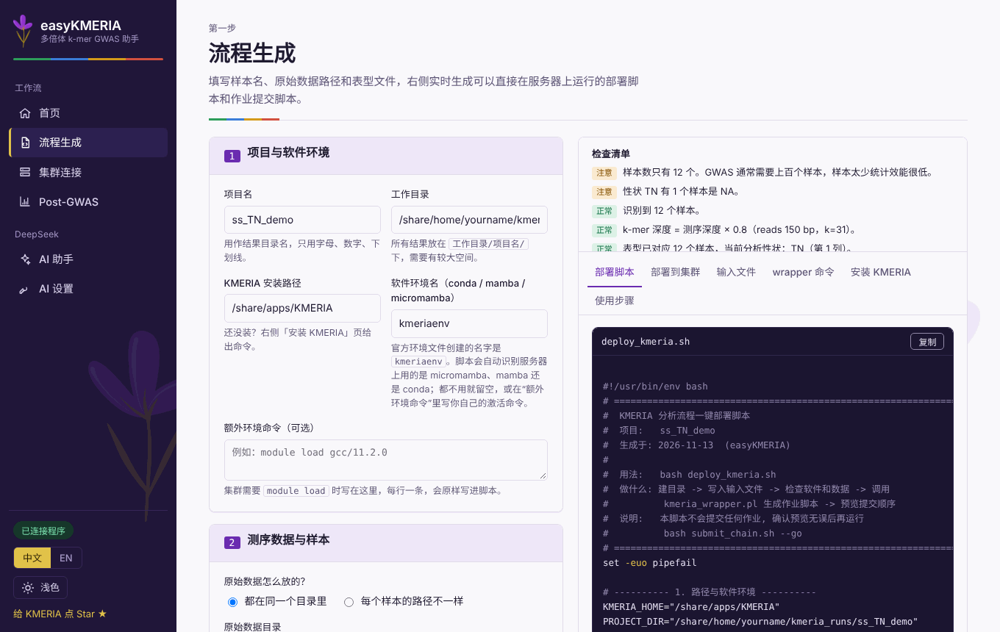
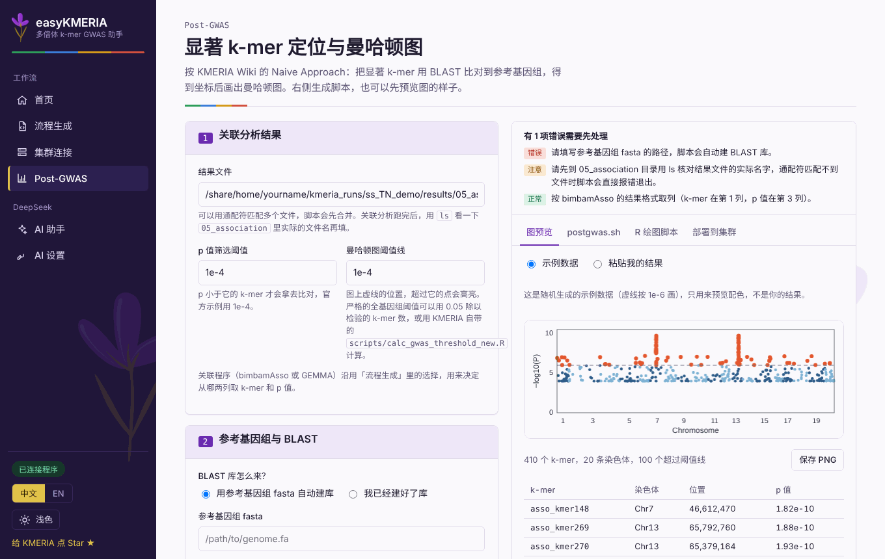
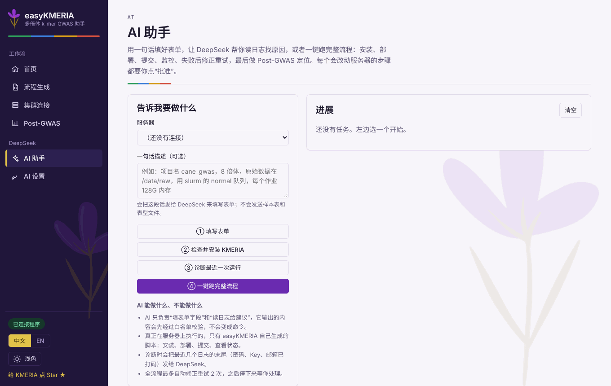

# easyKMERIA 使用指南

[English](USER_GUIDE.md) | 简体中文

这份指南带你走完一次完整分析：从原始测序数据到曼哈顿图。如果你只想要脚本，做完第 1、2 步就够了，其余都是可选的便利功能。

目录：[启动](#启动) · [1. 流程生成](#1-流程生成生成脚本) · [2. 连接服务器](#2-连接服务器) · [3. 部署和提交](#3-部署和提交) · [4. Post-GWAS](#4-post-gwas定位显著-k-mer-并画图) · [AI 助手](#ai-助手) · [软件环境](#软件环境) · [常见问题](#常见问题)

## 启动

```bash
cd easyKMERIA
./start.sh            # Windows 双击 start.bat
```

浏览器没有自动打开的话，访问 <http://127.0.0.1:8765>。左侧导航底部的按钮可以在中文和 English 之间切换（页面会重新加载）。

你需要一个能 SSH 登录的 Linux 集群账号，并且服务器上装了 KMERIA（也可以让 [AI 助手](#ai-助手)帮你安装）。程序运行在你自己的电脑上，集群上不需要装任何东西。

## 1. 流程生成：生成脚本

<p align="center"></p>

打开**流程生成**，填写左侧表单，右侧会随着你的输入实时更新。

1. **项目与软件环境。** 项目名（用作文件夹名）、工作目录（所有结果都放在 `工作目录/项目名/` 下，请选空间足够的磁盘）、KMERIA 安装路径，以及 conda / mamba / micromamba 的环境名（用官方 `kmeria_env.yaml` 创建的话是 `kmeriaenv`）。
2. **测序数据与样本。** 选择原始数据的放法：要么指向一个文件夹，里面的文件按 `样本名_R1.fq.gz` / `样本名_R2.fq.gz` 命名；要么在样本表里逐个写出每个样本的 R1、R2 路径（easyKMERIA 会用软链接统一命名，不会改动你的原始数据）。每行一个样本：样本名、测序深度，可再加一列倍性。
3. **表型文件。** 粘贴或上传包含样本名和一个或多个性状的表格，选择要分析的性状，缺失值写 `NA`。
4. **分析参数。** 倍性、k-mer 长度（做 GWAS 建议不超过 31）、最小/最大丰度、缺失率阈值、计数工具（`kmeria count` 或 KMC）、关联工具（`bimbamAsso` 或 GEMMA）、调度系统、队列、线程、内存和时间。**“运行哪些步骤”请保持“全部”**，除非你确实只想单独重跑某一步。

右上角的**检查清单**会在运行之前提示问题，例如样本太少、有样本没有表型、安装路径不是绝对路径。先处理红色的错误。

右侧各标签页的内容：

| 标签页 | 内容 |
| --- | --- |
| 部署脚本 | `deploy_kmeria.sh`：建目录、写输入文件、检查软件和数据、调用 `kmeria_wrapper.pl`，并写出 `submit_chain.sh` |
| 部署到集群 | 同上，但直接在页面里运行（见第 3 步） |
| 输入文件 | `sample.list`、`sample_depth.tsv`、`phenotypes.txt`，方便你核对 |
| wrapper 命令 | 实际使用的那一条 `kmeria_wrapper.pl` 命令，路径已展开，方便对照 KMERIA Wiki |
| 安装 KMERIA | 官方预编译方式的安装命令 |

你也可以把 `deploy_kmeria.sh` 复制到集群上自己运行：`bash deploy_kmeria.sh`。它只做准备和预览，不会提交任何作业。

## 2. 连接服务器

打开**集群连接**，点击添加。填写主机、端口、用户名，以及密码或私钥，再填工作路径和队列。点**测试连接**会登录、记录服务器指纹，并识别调度系统和可用的环境管理器。密码和私钥加密后保存在你自己的电脑上。

## 3. 部署和提交

在**流程生成 → 部署到集群**里选一个已保存的服务器，依次用三个按钮：

1. **上传并运行**：把 `deploy_kmeria.sh` 传到项目目录并运行。会建好 `results/` 并写出各步骤的作业脚本，不会提交作业。
2. **提交作业**：运行 `submit_chain.sh --go`。第一次点击是“预备”，再点一次才真正执行。各步骤的作业会按依赖提交：后一步等前一步全部成功后才开始。
3. **刷新状态**：列出你账号下排队和运行中的作业。

按钮下方可以浏览服务器上的目录，并查看任意日志的最后 150 行。

结果目录结构：

```
<工作目录>/<项目名>/
├── sample.list  sample_depth.tsv  phenotypes.txt
├── deploy_kmeria.sh  submit_chain.sh  easykmeria_env.sh
└── results/
    ├── 01_kmer_counts/  02_kmer_matrices/  03_filtered_matrices/  04_bimbam/
    └── 05_association/      <- 关联分析结果
```

## 4. Post-GWAS：定位显著 k-mer 并画图

<p align="center"></p>

关联分析跑完后打开 **Post-GWAS**，它按 KMERIA Wiki 的 Naive Approach 做。

1. **关联分析结果。** 填 `results/05_association/` 里结果文件的路径（可用通配符），以及用于比对的 p 值阈值。先在服务器上 `ls results/05_association` 看看真实文件名。列的格式由你选的关联工具（bimbamAsso 或 GEMMA）决定。
2. **参考基因组与 BLAST。** 给出参考基因组 fasta，程序会在脚本里自动建 BLAST 库；也可以指向已经建好的库。还可以加一个 GFF3 文件来列出附近的基因。
3. **曼哈顿图。** 阈值线、标题、配色和其他样式选项（见下）。
4. **在集群上运行。** “部署到集群”标签页会上传并运行生成的 `postgwas.sh`，产出显著 k-mer 的比对表、曼哈顿图（按你的选择输出 PNG 和/或 PDF）；如果给了 GFF3，还有附近基因列表。

**图预览**标签页会用示例数据（或你粘贴的结果）画一张图，让你在运行前先挑好颜色和选项。预览用的选项和集群上运行的 R 脚本一致。

### 用 DeepSeek 改曼哈顿图

在 Post-GWAS 页的 AI 一栏里写出你的要求，然后点执行。例如：

> 点小一点，只要 300 dpi 的 PNG，隐藏阈值线，标出前 10 个，换成色盲友好的配色

DeepSeek 可以修改：配色、点大小、高亮点大小、透明度、纵轴上限、阈值线（显示/隐藏、线型、可选的第二条阈值线）、网格、染色体名前缀、点形状、输出格式和 dpi、标注的 k-mer 个数、字号。页面会列出“改了什么（旧 → 新）”和“**做不到**的部分”，并提供一键撤销。它只会改你自己也能手动设置的绘图选项，模型不会写出会被执行的代码。

## AI 助手

<p align="center"></p>

请先在 **AI 设置**里保存 DeepSeek API Key。AI 助手提供四件事，都在已保存的服务器上进行，每一步都由你确认：

1. **一句话填表单。** 例如“项目 cane_gwas，8 倍体，数据在 /data/raw，slurm normal 队列，每个作业 128G 内存”。先给出“现在 → 改成”的对照，你点“应用”才写入。
2. **检查并安装 KMERIA。** 安装目录是空的就展示完整安装脚本（git clone + conda 环境，按官方 README），你批准后在服务器后台运行。目录非空会自动停止，不覆盖、不用 sudo、不删文件。
3. **诊断最近一次运行。** 读取最近的 `.err/.out/.log` 末尾几十行（密码、Key、邮箱会先打码），返回原因和建议；内存、时限等参数建议可以一键应用到表单。
4. **一键跑完整流程。** 检查环境 → 部署 → 提交 → 监控 → 失败时诊断并提议修正（最多重试 2 次）→ Post-GWAS。部署、提交、安装、重试、Post-GWAS 提交每一步都需要你批准，随时可以停止。

AI 只返回表单取值（后端按白名单校验：路径含 `..` 或特殊字符、越界数值、未知字段都会被丢弃）和文字建议。服务器上真正运行的只有 easyKMERIA 自己生成的脚本和固定的几个动作（上传、运行脚本、提交、看作业、看日志），且限制在工作路径内。日志里夹带的“指令”被当作数据，不会被执行。

## 软件环境

部署脚本会自己找 **micromamba、mamba 或 conda**，不依赖 `.bashrc` 里的初始化（很多服务器的 `.bashrc` 在非交互模式下会提前返回）。查找顺序：`PATH` → `MAMBA_EXE` / `CONDA_EXE` → `~/.bashrc` 等文件里写过的路径（只读取，不执行）→ 常见安装位置。哪个工具里有表单里填的环境名，就用哪个。

部署时还会在项目目录写出 `easykmeria_env.sh`（你的额外环境命令、环境激活、KMERIA 的 `LD_LIBRARY_PATH` 和 `PATH`），并在每个作业脚本第一条命令前加一行 `source`。所以作业不依赖提交时的环境，在计算节点上也找得到 `kmc` 等命令。作业脚本其余内容不变，重复部署不会重复添加。

如果仍然找不到，在服务器终端运行 `type -a micromamba conda`，把目录以 `export PATH="<目录>:$PATH"` 的形式写进表单里的“额外环境命令”。

## 常见问题

**提交预览里提示“没有找到作业脚本”。** 对应的步骤目录 `results/0X_…/` 里还没有作业脚本。请确认部署脚本运行时没有 `[缺失]` 提示，并且“运行哪些步骤”是**全部**。只跑单步的话，只会有那一步的脚本。

**只生成了 `05_association/asso_job.sh`，或出现了重复的 `05_association/05_association/` 目录。** 旧版 easyKMERIA 把步骤目录当作 `--output` 传给 wrapper。`kmeria_wrapper.pl` 把 `--output` 当作**基础目录**，会自己再加一层步骤目录。请更新到这个版本并重新运行部署脚本；重复的目录可以删掉。

**wrapper 输出 `Use of uninitialized value $original_order ...`。** wrapper 会在基础目录下找 `01_kmer_counts/sample_order.txt`，这个目录不存在时就会出现该警告，例如输出路径像上面那样被嵌套时。用 `--output <项目>/results` 就不会出现。

**作业日志里出现 `kmc: command not found`。** 作业没有拿到环境。请用这个版本重新运行部署脚本（它会写出 `easykmeria_env.sh` 并修改作业脚本），再重新提交；用旧脚本提交过的作业先 `scancel <作业号>`。

**DeepSeek 提示证书校验失败（`CERTIFICATE_VERIFY_FAILED`）。** 校园网、公司网络和某些代理软件会在中途替换 HTTPS 证书。按顺序试：(1) `pip install truststore` 后重启（`./start.sh` 会自动装好），让程序使用系统证书库；(2) 向网络管理员要根证书（PEM 格式），把路径填到 **AI 设置 → CA 证书文件**，或用 `SSL_CERT_FILE=/路径/ca.pem python app.py` 启动；(3) macOS 的 python.org 安装包要运行一次 `Install Certificates.command`。程序不提供“跳过证书校验”，那样 API Key 会在不受保护的连接上传输。

**用在别处能登录的密码却登录失败。** 只支持普通密码认证。集群要求验证码的话，请改用私钥。

**服务器指纹变了。** 程序会拒绝连接，因为可能连到了别的机器。如果你确认服务器重装过，在该连接上点**编辑**，勾选“重新记录服务器指纹”。

## 引用

Chen Shuai *et al.* A k-mer-based GWAS approach empowering gene mining in polyploids. *Nature Genetics* (2026). doi:[10.1038/s41588-026-02641-8](https://doi.org/10.1038/s41588-026-02641-8)
